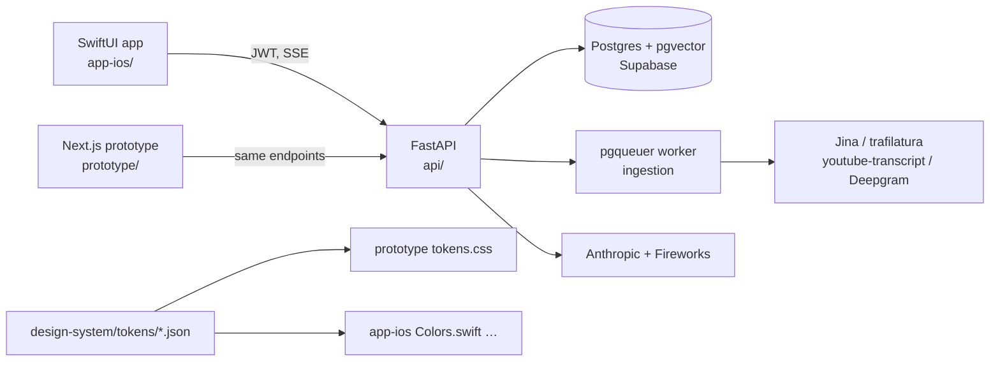

# Nexus

AI-native content curation for iPhone: save links, ask questions, create from what you saved.

**Status:** In TestFlight (build 17). Source-available — see [LICENSE](LICENSE).

<!-- screenshots: docs/screenshots/*.png -->

## What it is

Everything lives in a **Collection** — a research space with its own AI. No global library, no inbox; a saved link always lands in a collection.

Each collection has three tabs:

- **Ask** — chat grounded in the sources (default landing)
- **Create** — audio overview, infographic, poster, quiz
- **Sources** — the links, extracted content, status

Two ways to start one: **Research a topic** (Claude finds sources, streamed in one by one) or **Start with a link**. IA and terminology: [SPEC.md §5a](SPEC.md).

## Architecture



- **iOS**: SwiftUI, native-first (Form, Menu, detented sheets, `glassEffect` on iOS 26). ~14k lines of Swift.
- **Backend**: FastAPI + async SQLAlchemy on Supabase Postgres; research and chat stream over SSE; ingestion via a pgqueuer worker; deployed on Render (`render.yaml`).
- **Prototype**: Next.js 14 against the real backend. A design tool, not a product.
- **Design system**: four token JSON files generate the CSS custom properties and the Swift enums.

## How it is built

I design in the browser, not in Xcode. Flows are iterated in `prototype/` and reviewed on my iPhone in Safari against the live backend, so latency and streaming are design material. A flow is "port-ready" only after phone testing, including keyboard-up states.

The **fidelity contract** exists because earlier HTML designs never translated 1:1 to SwiftUI. Rules: system font stack, every value from tokens (`prototype/src/lib/tokens.ts` holds only `var()` references), and only primitives with exact SwiftUI mappings. Liquid Glass, springs, haptics and sheets are "device-final". Each port batch ends with a prototype-vs-simulator screenshot diff.

Mechanical work runs through an autonomous build loop: **Architect → Planner → SWE → Test → Review**. It does backend, wiring, tests and ports of locked specs — never UI judgment. It shipped Apple Sign-In and source status polling; it also once fabricated a fix, which Review caught. Logs: [docs/process/AGENT_LOG.md](docs/process/AGENT_LOG.md), [docs/process/CHECKPOINT.md](docs/process/CHECKPOINT.md). Deferred decisions: [PARKING_LOT.md](PARKING_LOT.md).

## Craft notes

- **One token source, two targets.** 181 `$value` entries in `design-system/tokens/*.json` generate `prototype/src/styles/tokens.css` and `app-ios/.../DesignSystem/*.swift`. Dark mode (build 16) was a token change, not a per-view rewrite.
- **The glass tab bar I stopped building.** After reimplementing the droplet physics for weeks, a device review showed the exact effect is the native `UISegmentedControl` on iOS 26. `GlassTabBar.swift` now wraps the real control; a material bar remains for < iOS 26.
- **Research streams as SSE**: `searching` → one `source` event per result → `done` with the collection id (`api/app/routers/research.py`). Chat streams `sources` → `chunk` → `done`.
- **Spring easing baked to CSS `linear()`** from a k=200 / c=15.5 / ζ≈0.55 simulation (`motion.json`); no rAF springs.
- **Research runs on Haiku by default** after an A/B (~50% cheaper); `web_search` capped at 6 calls.
- **Worker polls instead of LISTEN/NOTIFY** — Supabase's pooler does not relay notifications. `pgqueuer` is pinned to 1.1.1 in `api/requirements.txt` (what Render installs; `pyproject.toml` still says `^0.16`) after a floating version crash-looped the worker.
- 271 commits, 38 backend test files, ~23k lines of Python including tests (~9k app code).

## Repository map

```
api/            FastAPI backend, Alembic migrations, extraction pipeline, tests
app-ios/        SwiftUI app + Share extension
prototype/      Next.js design prototype (semi-live against the API)
design-system/  Token JSON (source of truth) + assets
docs/process/   Build-loop logs, checkpoints, TestFlight notes
app-store/      Store listing copy
```

## Run locally

**API** — `cd api && uv sync && uv run uvicorn app.main:app --host 0.0.0.0 --reload`. Needs `DATABASE_URL`, `SUPABASE_URL`, `SUPABASE_PUBLISHABLE_KEY`, `SUPABASE_SECRET_KEY`, `SUPABASE_SERVICE_ROLE_KEY`, `ANTHROPIC_API_KEY`, `FIREWORKS_API_KEY`, `APPLE_APP_BUNDLE_ID`. Optional: `DEEPGRAM_API_KEY`, `JINA_API_KEY`, `YOUTUBE_API_KEY`, `FAL_KEY`. See `api/.env.example`.

**Prototype** — `cd prototype && npm install && npm run dev`. Set `NEXT_PUBLIC_API_URL`.

**iOS** — open `app-ios/Nexus` in Xcode; set `API_BASE_URL` in the scheme environment.

## Why source-available

The code is open to read, run and learn from — the token pipeline, the SSE design, the build-loop logs, the mistakes. It is not licensed for commercial redistribution. For anything beyond that, ask.

— Srihari Srinivasa · https://srihari.page
